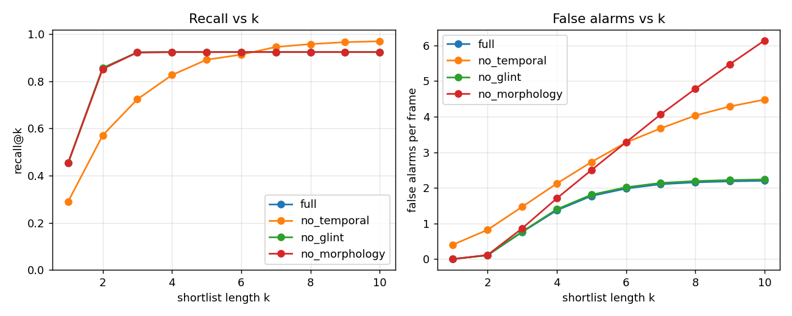

# Vision-Assisted Survivor Localisation in Maritime SAR using Texture-Anomaly Modelling

FCV mini-project. Tanish Hemant Kuvar (240962540), M. Vishal Kumar (240962546), Samyak Jain (240962638), AIML-A.

The system takes aerial RGB imagery of open water and returns a ranked shortlist of at most *k* regions
per frame that are likely to contain a person, each with a confidence value, drawn as an overlay for the
operator. It **models the water, not the person**: normal sea texture is described per tile with an
oriented Gabor filter bank tuned to the dominant wave spectrum and a uniform LBP histogram, and tiles
that deviate from the frame's own "normal sea" reference become candidates. Sun glint, foam and
whitecaps are then removed by colour, shape and time. It uses only classical OpenCV/NumPy operations and
**needs no training data**.

```
frame ─► 1 normalise ─► 2 Gabor + LBP per tile ─► 3 chi-square anomaly map ─► 4 glint test ─► 5 morphology ─► 6 temporal ─► top-k overlay
```

## Quick start

```bash
pip install -r requirements.txt
python -m sarvision synth --out data/synthetic          # render the synthetic benchmark (6 sequences x 60 frames)
python -m sarvision web                                 # browser operator console (http://127.0.0.1:8765)
python -m sarvision gui data/synthetic/seq02.mp4        # Tkinter operator / tuning GUI
python -m sarvision run --input data/synthetic/seq02.mp4 --output results/demo/seq02_annotated.mp4 --csv results/demo/seq02_shortlist.csv
python -m sarvision evaluate --coco data/synthetic/annotations.json --ablations full,no_temporal,no_glint,no_morphology --out results/synthetic
python -m pytest -q                                     # 40 unit / integration tests
```

`run` accepts a video, a folder of frames or a single image. Every parameter can be overridden with
`--set key=value` (repeatable) or a JSON file from `python -m sarvision config --dump config.json`.

## Project layout

| file | contents |
|---|---|
| `sarvision/config.py` | every tunable parameter (one dataclass shared by GUI, CLI and evaluation); auto tile size; altitude → pixel-size conversion |
| `sarvision/normalise.py` | **Stage 1**: flat-fielding, CLAHE, piecewise-linear contrast stretch |
| `sarvision/texture.py` | **Stage 2**: FFT wave-spectrum estimate, Gabor bank, uniform LBP, overlapping-tile descriptors |
| `sarvision/anomaly.py` | **Stage 3**: robust local reference, chi-square distances, robust z-score fusion, dense anomaly map, candidate pixels |
| `sarvision/glint.py` | **Stage 4**: rgb-chromaticity glint test |
| `sarvision/morphology.py` | **Stage 5**: opening/closing, connected components, area / eccentricity / solidity filter |
| `sarvision/tracking.py` | **Stage 6**: nearest-neighbour association, persistence, coherent-drift test, ranking |
| `sarvision/pipeline.py` | ties the stages together; optional camera-motion compensation (phase correlation) |
| `sarvision/viz.py` | renders every intermediate stage and the operator overlay |
| `sarvision/web/` | browser console: analyses the whole sequence in the background (stages 1-5 in parallel), then plays it back with ranked targets, track trails, ground-truth hits, live recall / precision / false alarms, split-screen stage compare, wave-spectrum telemetry and live re-tuning |
| `sarvision/gui.py` | Tkinter GUI: load a sequence, inspect each stage, tune parameters, view the overlay, export |
| `sarvision/datasets.py` | loaders: COCO JSON (SeaDronesSee, MOBDrone) and YOLO txt (AFO) |
| `sarvision/metrics.py`, `evaluate.py` | recall@k, false alarms / frame, precision, size and altitude stratification, ablations, plots |
| `sarvision/synthetic.py` | synthetic sea sequences with ground truth (waves, glitter, whitecaps, debris, drifting people) |
| `tests/` | unit tests for every stage plus end-to-end tests |

## Method

### Stage 1: normalisation (`normalise.py`)
The lightness channel (Lab *L*) is
1. **flat-fielded**: divided by a heavily Gaussian-smoothed copy of itself, the illumination estimate
   (σ = 1/8 of the frame width). This removes the sun-side / far-field brightness gradient and evens out
   wave contrast between bright and dark regions;
2. **equalised with CLAHE** (clip 2.0, 8×8 regions), i.e. histogram equalisation done per region;
3. **contrast-stretched** with a three-segment **piecewise-linear** transform whose knees map the 1st and
   99th percentiles to 10 and 245.

### Stage 2: texture characterisation (`texture.py`)
* **Wave spectrum.** The frame is split into 3 horizontal bands (far, middle and near field). For each band
  the 2-D DFT of a Hann-windowed patch gives a power spectrum; its strongest peak in the 4–32 px
  wavelength annulus gives the dominant **wavelength** (1/|f|) and **orientation** (angle of the wave
  vector).
* **Gabor bank.** For every distinct band wavelength, 4 orientations (the dominant one, then +45°, +90°,
  +135°), σ = 0.56 λ (about one octave), γ = 0.5. Each filter is applied as an even/odd (cos/sin) pair and
  the **local energy** √(even² + odd²) is used, which does not depend on wave phase. Long-wavelength
  filters run on a 2× or 4× downsampled copy (still at least 4 px per cycle), which gives the same tile
  averages at a fraction of the cost.
* **Uniform LBP.** 8-neighbour LBP codes (bit = neighbour ≥ centre) mapped to the 59 uniform bins.
* **Overlapping tiles.** Tile side *T* and stride *T/2* (so a person on a tile border is not split). With
  `auto_tile` (default) *T* is about 2× the expected person size: 0.5 m / GSD × 2.5 when altitude is known,
  otherwise 32 px at 1920 px width scaled with frame width (16–64 px). Statistics are first summed over
  stride×stride cells and then box-summed, so overlap costs nothing extra.
* **Descriptor per tile:** mean Gabor energy of every filter + normalised 59-bin LBP histogram.

### Stage 3: anomaly scoring (`anomaly.py`)
* **Reference "normal sea"** = the **median** descriptor over overlapping 9×9-tile windows, interpolated
  back to every tile (`reference="local"`; `"band"` and `"global"` are also available). It is estimated from
  the frame itself. The median, rather than the mean, keeps the reference clean when a boat or a person
  covers some tiles, and the local window adapts to near/far field.
* **Chi-square distance** of each tile to its reference, computed separately for the LBP histogram and for
  the reference-normalised Gabor energies: χ² = ½ Σ (a−b)²/(a+b).
* The two distances are put on one scale with a **robust z-score** (median and 1.4826·MAD over all
  tiles) and averaged (`lbp_weight` 0.5). Within one Gabor kernel radius of the frame edge, where the
  filters see padding, the score falls back to the LBP term alone.
* **Dense anomaly map**: each pixel takes the maximum z of the tiles covering it; **threshold** z > 3.
* Inside the anomalous region, **candidate pixels** are those whose Lab colour differs from the local sea
  colour (median-filtered background) by more than median + 4·σ_MAD. This gives a pixel-accurate blob
  instead of a whole tile.

### Stage 4: glint suppression (`glint.py`)
Specular glint saturates all channels together, so its **rgb chromaticity** (R,G,B)/(R+G+B) is close to
(⅓,⅓,⅓). A pixel is glint if it is **bright** (mean ≥ 0.8·255) **and achromatic** (chromaticity distance
from grey ≤ 0.06). Candidate components that are mostly glint are dropped and glint pixels are cleared
from the rest. Requiring brightness *and* low chroma keeps dark, colourless targets such as a black
wetsuit.

### Stage 5: morphological refinement (`morphology.py`)
Opening (3×3 ellipse) removes specks and closing (5×5) joins the fragments of a partly submerged body.
`connectedComponentsWithStats` (8-connectivity) labels the blobs, and each blob must pass:
**area** in [12, 2500] px (or derived from altitude through the ground sampling distance),
**eccentricity** ≤ 0.97 (from second-order moments; rejects foam streaks) and **solidity** = area / convex
hull area ≥ 0.45 (rejects ragged foam). Each surviving blob is scored by peak tile z × mean colour
contrast, and its confidence is s / (s + 50).

### Stage 6: temporal association (`tracking.py`)
Detections are linked frame to frame by **greedy nearest neighbour** around a constant-velocity prediction
(radius 40 px). A track is **promoted** after `min_persistence` = 5 hits if its drift is **coherent**:
coherence = exp(−spread / 6 px), where spread is the RMS deviation of the step velocities from their mean,
and it must be ≥ 0.25. Short gaps (a head under a wave) are tolerated for 3 frames. Whitecaps and glint
flashes vanish before promotion; random re-associations between different whitecaps fail the coherence
test. Optional camera-motion compensation estimates the frame-to-frame translation by **phase
correlation** and shifts all tracks.

**Ranking:** confidence = 0.4 × (anomaly confidence, EMA over the track) + 0.6 × (min(hits, 10)/10 ×
coherence), down-weighted ×0.8 per missed frame. The top *k* are shown.

## Evaluation

| metric | meaning |
|---|---|
| recall@k | fraction of annotated people that appear in the top-k shortlist |
| false alarms / frame | shown boxes (top-k) that match no person, averaged over frames |
| precision@k | fraction of shown boxes that hit a person |
| by size / by altitude | recall@k per target-size bin (√(w·h): <16, 16–32, 32–64, ≥64 px) and per altitude bin |
| steady-state | the same numbers without the first `min_persistence − 1` frames of each sequence (the temporal stage cannot have promoted anything yet) |
| ablation | the full system vs. the same system with one stage switched off |

**Hit rule.** IoU is very harsh on 10–30 px boxes, so a prediction counts as a hit when its centre lies
within max(8 px, max(gt_w, gt_h)) of the ground-truth centre. `--criterion iou --iou 0.5` switches to IoU.

### Results on the synthetic benchmark
`python -m sarvision synth` renders 6 sequences × 60 frames (1280×720, 10 fps) covering altitudes of
50–150 m, calm to rough sea, strong sun glitter, a dark-clothed person and a panning camera: 739
annotated person instances. **These are synthetic numbers.** They check that the pipeline and the
evaluation work end to end; they are not a claim about real-world performance. The public datasets
below are needed for that.

k = 5, centre hit rule, default parameters (`results/synthetic/results.md`, `results.json`):

| run | recall@5 | precision@5 | false alarms / frame | steady-state recall@5 | steady-state FA / frame | fps |
|---|---|---|---|---|---|---|
| **full system** | **92.4%** | **51.7%** | **1.77** | **99.3%** | **1.90** | 2.7 |
| without temporal stage | 89.2% | 40.2% | 2.73 | 88.7% | 2.80 | 2.6 |
| without glint suppression | 92.4% | 51.2% | 1.81 | 99.3% | 1.94 | 2.8 |
| without morphology / shape filter | 92.4% | 45.7% | 2.50 | 99.3% | 2.68 | 2.7 |

Recall vs shortlist length:

| run | k=1 | k=2 | k=3 | k=5 | k=10 |
|---|---|---|---|---|---|
| full | 45.3% | 85.7% | 92.3% | 92.4% | 92.4% |
| without temporal | 29.0% | 57.1% | 72.4% | 89.2% | 97.0% |

(Most frames contain 2–3 people, so recall@1 cannot exceed about 45%.)

Recall@5 by altitude (full system): <60 m 93.2%, 60–100 m 92.9%, 100–140 m 89.0%, ≥140 m 93.3%.
By target size: <16 px 92.2% (n = 618), 16–32 px 93.4% (n = 121).

What the ablation shows:
* **Temporal stage.** False alarms per frame drop by 35% (2.73 → 1.77) and precision rises from 40% to 52%.
  Persistence also lifts people above transient clutter in the ranking, so recall@3 goes from 72% to 92%.
  The cost is the warm-up: no box can be shown in the first 4 frames of a sequence. That is why overall
  recall@5 (92.4%) is below steady-state recall (99.3%), and why the no-temporal run is ahead at k ≥ 7.
* **Morphology / shape filter.** Removes elongated foam and debris: false alarms per frame drop from 2.50
  to 1.77.
* **Glint suppression** has only a small effect here (1.81 → 1.77 false alarms per frame). The synthetic
  glitter specks are 1–3 px, so most of them are already removed by the opening and the minimum-area
  limit. On real footage with larger glint patches this stage is expected to matter more, which is a
  question for the public datasets.
* Throughput is about 2.7 frames/s for 1280×720 on a laptop CPU in pure Python/OpenCV.



### Running on the public datasets
The method has no training step, so annotated data is used only to measure performance and to tune
thresholds. Check each dataset's page for the current download link and licence.

* **SeaDronesSee** (Univ. of Tübingen; object-detection and MOT splits, COCO JSON with per-image
  `meta` such as altitude and gimbal pitch):
  ```bash
  python -m sarvision evaluate --coco path/to/instances_val.json --images path/to/images/val --use-altitude --out results/seadronessee
  ```
  The MOT split's `video_id` / `frame_index` fields group frames into sequences, so the temporal stage is
  used. Results are also reported per altitude bin.
* **MOBDrone** (CNR-ISTI; man-overboard drone video, COCO JSON):
  ```bash
  python -m sarvision evaluate --coco path/to/annotations.json --images path/to/frames --as-sequence --out results/mobdrone
  ```
  Use `--as-sequence` when frames of one clip have no `video_id`.
* **AFO** (Aerial dataset of Floating Objects; YOLO txt labels, class 0 = human):
  ```bash
  python -m sarvision evaluate --yolo path/to/AFO/images --person-classes 0 --out results/afo
  ```
  AFO is mostly single images, so those frames are scored without the temporal stage (and the report
  counts how many).

Category names matching `swimmer|person|human|floater|people|overboard|^man$` count as people
(`--person-regex` to change). Other annotated objects (boats, buoys) are reported separately as
"FA excl. other objects", since flagging a boat is a correct anomaly but not a person. 4K frames are
processed at `max_width` = 1920 px by default; for very small targets use `--set max_width=3840`.
For high-frame-rate video raise `min_persistence` so that it outlasts a whitecap (about 1–2 s).

## Mapping to Lab Sessions 1–5

| technique used | where |
|---|---|
| intensity transforms: piecewise-linear contrast stretch | `normalise.piecewise_linear` |
| histogram processing: (adaptive) histogram equalisation | `normalise.normalise` (CLAHE) |
| spatial filtering: Gaussian smoothing, median filtering, convolution with Gabor kernels | `normalise.flat_field`, `anomaly.colour_deviation`, `texture.gabor_energy` |
| frequency domain: 2-D DFT power spectrum | `texture.estimate_wave` |
| texture: local binary patterns, uniform LBP histograms, chi-square histogram distance | `texture.uniform_lbp`, `anomaly.chi_square` |
| colour spaces: Lab, normalised rgb chromaticity | `anomaly.colour_deviation`, `glint.chromaticity` |
| thresholding: robust (median + k·MAD) thresholds | `anomaly.score_anomalies` |
| morphology: opening, closing, structuring elements | `morphology.refine` |
| connected components, moments, convex hull (area, eccentricity, solidity) | `morphology.refine`, `eccentricity`, `solidity` |

Check this against your own lab list before the viva.

## Limitations

* **Synthetic only, so far.** The reported numbers come from the synthetic benchmark. Real-data numbers
  need the datasets above.
* **Dark, colourless targets** produce weak colour and texture contrast; recall on them is lower.
* **White or grey clothing** can be removed by the glint test if it is very bright; the brightness
  requirement reduces this but does not remove it.
* **Non-sea content** (coastline, a large ship) covering much of a local reference window contaminates
  the reference; the median limits but does not remove this.
* **Persistent clutter** (a whitecap that lasts longer than `min_persistence`, or floating debris) can be
  promoted. Debris is a legitimate anomaly but not a person.
* **Warm-up**: with the temporal stage on, nothing is shown in the first `min_persistence − 1` frames of a
  sequence.
* **Camera motion**: phase correlation models translation only. Rotation and zoom need homography-based
  registration.
* **Hand-tuned parameters**: thresholds may need retuning for a new camera or sea state. All of them are
  exposed in the GUI and in JSON.
* **Night / thermal** imagery is out of scope: the colour test assumes daylight RGB.
